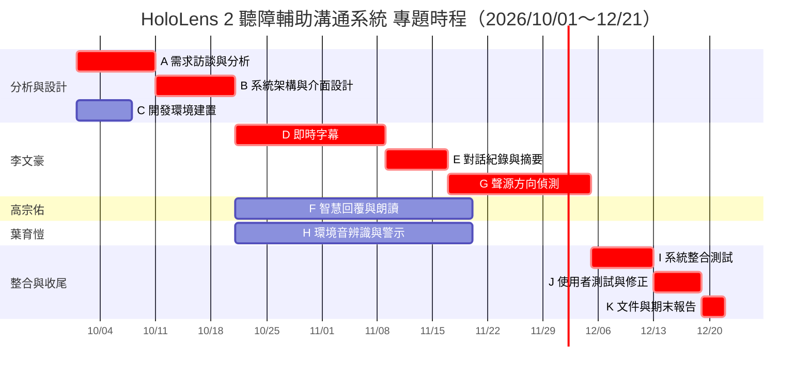
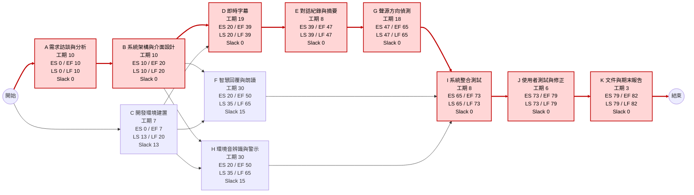

# 小組作業2

系統分析與設計115-1 第二組｜專題：HoloLens 2 聽障輔助溝通系統

## 一、個別組員任務

| 組員 | 角色 | 負責項目 |
|---|---|---|
| 李文豪 | 組長 | 專案時程管理與進度追蹤 即時字幕：Azure 語音辨識、原始麥克風擷取、自動斷句、字幕介面 對話紀錄與摘要：逐句記錄、回顧面板、以 Gemini API 摘要最近 10／30／60 分鐘 聲源方向偵測：多麥克風時間差估計方位、配戴者本人語音判斷 系統整合與實機部署（HoloLens 2） |
| 高宗佑 | 組員 | 智慧回覆：依對話內容產生 4 句建議回覆、提示詞設計、逾時與失敗處理 回覆朗讀：使用者點選後以語音合成唸出 智慧回覆實機測試 |
| 葉育愷 | 組員 | 環境音辨識：警報聲、救護車鳴笛、門鈴等安全相關聲音的偵測 環境音資料蒐集與模型測試 環境音視覺警示介面 |
| 全體 | — | 需求訪談與分析、系統設計、整合測試、使用者測試、文件與期末報告 |

## 二、工作項目與時程

| 代號 | 工作項目 | 負責人 | 工期（天） | 前置工作 |
|---|---|---|---|---|
| A | 需求訪談與分析 | 全體 | 10 | — |
| B | 系統架構與介面設計 | 全體 | 10 | A |
| C | 開發環境建置（Unity、MRTK3、OpenXR） | 李文豪 | 7 | — |
| D | 即時字幕 | 李文豪 | 19 | B、C |
| E | 對話紀錄與摘要 | 李文豪 | 8 | D |
| F | 智慧回覆與朗讀 | 高宗佑 | 30 | B、C |
| G | 聲源方向偵測 | 李文豪 | 18 | E |
| H | 環境音辨識與警示 | 葉育愷 | 30 | B、C |
| I | 系統整合測試 | 全體 | 8 | F、G、H |
| J | 使用者測試與修正 | 全體 | 6 | I |
| K | 文件與期末報告 | 全體 | 3 | J |

說明：對話紀錄需要字幕先完成才能記錄，因此 E 接在 D 之後；李文豪同一時間只進行一項開發工作（D → E → G），避免人力重疊。

## 三、專題甘特圖

紅色為要徑（Critical Path）上的工作。

## 四、PERT/CPM 圖

每個節點標示：工期、最早開始／最早完成（ES／EF）、最晚開始／最晚完成（LS／LF）與寬裕時間（Slack），單位為天，第 0 天為 10/01。紅色節點為要徑。

### 要徑分析

| 工作 | ES | EF | LS | LF | Slack | 是否為要徑 |
|---|---|---|---|---|---|---|
| A | 0 | 10 | 0 | 10 | 0 | ✔ |
| B | 10 | 20 | 10 | 20 | 0 | ✔ |
| C | 0 | 7 | 13 | 20 | 13 | |
| D | 20 | 39 | 20 | 39 | 0 | ✔ |
| E | 39 | 47 | 39 | 47 | 0 | ✔ |
| F | 20 | 50 | 35 | 65 | 15 | |
| G | 47 | 65 | 47 | 65 | 0 | ✔ |
| H | 20 | 50 | 35 | 65 | 15 | |
| I | 65 | 73 | 65 | 73 | 0 | ✔ |
| J | 73 | 79 | 73 | 79 | 0 | ✔ |
| K | 79 | 82 | 79 | 82 | 0 | ✔ |

- **要徑：A → B → D → E → G → I → J → K**，總工期 10 + 10 + 19 + 8 + 18 + 8 + 6 + 3 = **82 天**（10/01～12/21）。
- 要徑上的工作（即時字幕、對話紀錄與摘要、聲源方向偵測）一旦延誤，整個專題就會延後，因此列為組長優先負責並每週追蹤。
- 智慧回覆與環境音辨識各有 15 天寬裕時間，必要時可延後開始，或把人力支援到要徑工作。
