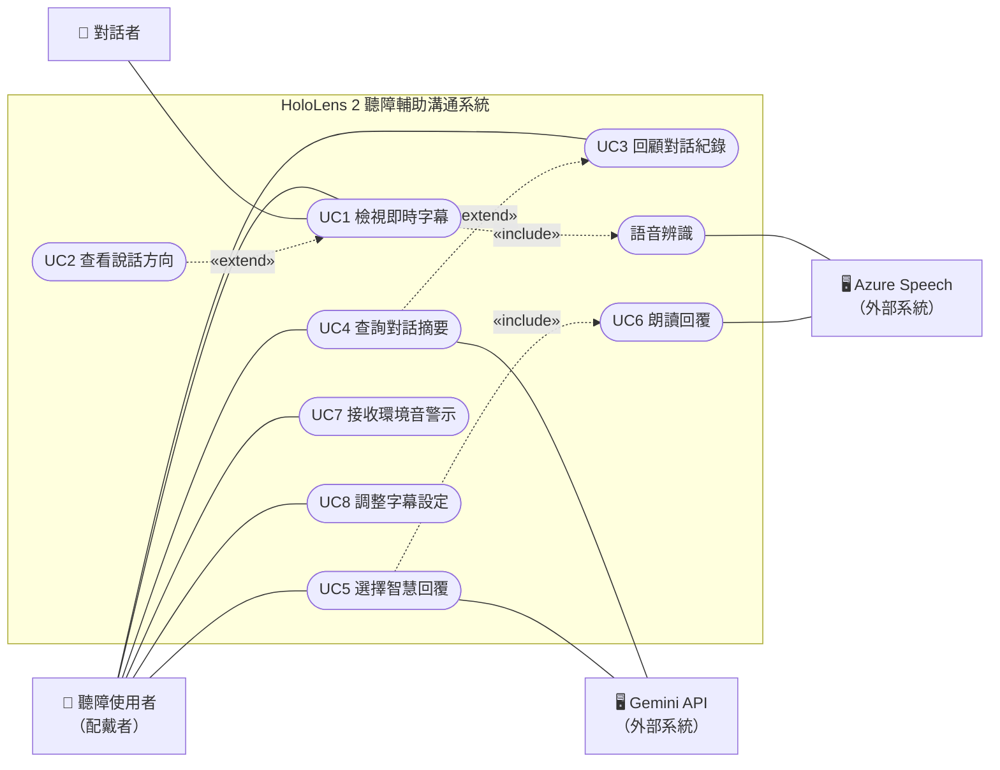

# 作業3：需求分析與使用案例

系統分析與設計115-1 第二組｜專題：HoloLens 2 聽障輔助溝通系統

## 一、功能性需求（Functional Requirements）

| 編號 | 需求名稱 | 說明 |
|---|---|---|
| FR-01 | 即時字幕 | 系統應持續擷取周圍語音，以 Azure Speech 辨識為繁體中文，並在 HoloLens 視野中的字幕面板即時顯示；辨識中的文字即時更新，一句結束後自動斷句換行。 |
| FR-02 | 說話方向標示 | 系統應以 HoloLens 2 內建麥克風陣列估計說話者方向（左、前、右、後），並在每句字幕前標示方向符號。 |
| FR-03 | 配戴者語音區分 | 系統應判斷一句話是否為配戴者本人所說，並以不同顏色標示為「我」，避免與他人說話混淆。 |
| FR-04 | 對話紀錄與摘要 | 系統應保存每句字幕與時間，使用者可回顧對話紀錄，並選擇以 Gemini 摘要最近 10、30 或 60 分鐘的對話。 |
| FR-05 | 智慧回覆 | 系統應依據對方最新一段話產生 4 句建議回覆；使用者點選後，系統以語音合成朗讀，代替使用者回應。 |
| FR-06 | 環境音警示 | 系統應偵測警報聲、救護車鳴笛、門鈴等安全相關聲音，並以圖示與文字在視野中顯示警示。 |
| FR-07 | 字幕設定 | 使用者可調整字幕字體大小、面板位置與是否顯示方向標示。 |

## 二、非功能性需求（Non-functional Requirements）

| 編號 | 類別 | 說明 |
|---|---|---|
| NFR-01 | 效能 | 說話者講完一句話後，最終字幕應在 1.5 秒內顯示；智慧回覆應在 12 秒內產生，超過則改用固定回覆句。 |
| NFR-02 | 準確度 | 說話方向在左、前、右、後四個方位的判斷正確率應達 80% 以上。 |
| NFR-03 | 可用性（普及設計） | 資訊不可只靠顏色傳達（方向同時以箭頭文字標示）；字幕字體可放大；主要操作以手勢點選 2 步內完成。 |
| NFR-04 | 可靠性 | 網路中斷或 AI 服務失敗（如逾時、HTTP 503）時，字幕以外的功能需退回預設行為，App 不可當機；朗讀建議回覆時，系統不可把自己的語音辨識成字幕。 |
| NFR-05 | 安全性與隱私 | API 金鑰不得存放於版本控制（以 .gitignore 排除）；對話紀錄僅存在裝置本機，除語音辨識與摘要所需外，不上傳至其他服務。 |
| NFR-06 | 相容性 | 系統須在 HoloLens 2（UWP / ARM64）上執行，採用 Unity 2022.3 LTS、MRTK3 與 OpenXR。 |

## 三、使用案例圖（Use Case Diagram）

說明：
- **聽障使用者**是主要參與者；**對話者**是說話被辨識的人；**Azure Speech**、**Gemini API** 是外部系統參與者。
- 「檢視即時字幕」一定會用到「語音辨識」（include）。
- 「查看說話方向」是在字幕上額外顯示方向，屬於擴充（extend）。
- 「選擇智慧回覆」點選後一定會「朗讀回覆」（include）。

## 四、使用案例描述

### UC1 檢視即時字幕（含說話方向）

| 項目 | 內容 |
|---|---|
| 使用案例名稱 | 檢視即時字幕 |
| 主要參與者 | 聽障使用者 |
| 次要參與者 | 對話者、Azure Speech |
| 前置條件 | 使用者已配戴 HoloLens 2 並開啟 App；裝置已連上網路；麥克風權限已允許。 |
| 主要流程 | 1. 對話者開始說話。 2. 系統擷取原始麥克風音訊，送至 Azure Speech。 3. 系統在字幕面板即時顯示辨識中的文字。 4. 系統同時估計聲音方向。 5. 對話者講完一句，Azure 回傳最終結果。 6. 系統以這句話期間的方向多數決，在字幕前加上方向符號（←左、↑前、→右、↓後）。 7. 字幕斷句換行，並存入對話紀錄。 |
| 替代流程 | 4a. 判斷為配戴者本人說話 → 字幕標示「我」並改為灰色。 6a. 方向一致率不足 → 不顯示方向符號。 2a. 網路中斷 → 面板顯示「語音辨識連線中斷」，恢復後自動重新連線。 |
| 後置條件 | 該句字幕已顯示並存入對話紀錄。 |

### UC5 選擇智慧回覆

| 項目 | 內容 |
|---|---|
| 使用案例名稱 | 選擇智慧回覆 |
| 主要參與者 | 聽障使用者 |
| 次要參與者 | Gemini API、Azure Speech（語音合成） |
| 前置條件 | 對方剛說完一段話，字幕已顯示。 |
| 主要流程 | 1. 系統偵測對方一段話結束。 2. 系統在面板顯示「產生回覆中…」，按鈕先維持 4 句固定回覆。 3. 系統將對話內容送至 Gemini，要求產生 4 句建議回覆。 4. Gemini 回傳後，系統過濾標點與過短句子，把 4 個按鈕換成建議回覆。 5. 使用者以手勢點選其中一句。 6. 系統以語音合成朗讀該句（include UC6），朗讀期間暫停把麥克風送去辨識。 |
| 替代流程 | 3a. 超過 12 秒未回應或回傳錯誤 → 保留固定回覆句並記錄警告。 4a. 等待期間對方又說了新的一段話 → 丟棄舊結果，以最新一段為準。 |
| 後置條件 | 回覆已朗讀；朗讀內容不會出現在字幕上。 |

### UC4 查詢對話摘要

| 項目 | 內容 |
|---|---|
| 使用案例名稱 | 查詢對話摘要 |
| 主要參與者 | 聽障使用者 |
| 次要參與者 | Gemini API |
| 前置條件 | 對話紀錄中已有字幕資料。 |
| 主要流程 | 1. 使用者開啟手部選單，點選「回顧」。 2. 系統顯示對話紀錄面板。 3. 使用者選擇摘要範圍（10、30 或 60 分鐘）。 4. 系統取出該時間範圍的字幕，送至 Gemini 摘要。 5. 系統在面板顯示摘要結果。 |
| 替代流程 | 4a. 該時間範圍沒有任何字幕 → 顯示「這段時間沒有對話紀錄」。 4b. Gemini 失敗或逾時 → 顯示「摘要失敗，請稍後再試」，原始紀錄仍可瀏覽。 |
| 後置條件 | 使用者看到所選範圍的對話摘要。 |

### UC7 接收環境音警示

| 項目 | 內容 |
|---|---|
| 使用案例名稱 | 接收環境音警示 |
| 主要參與者 | 聽障使用者 |
| 前置條件 | App 執行中，環境音偵測已開啟。 |
| 主要流程 | 1. 系統持續分析麥克風音訊。 2. 系統辨識出安全相關聲音（如火災警報、救護車鳴笛、門鈴）。 3. 信心值超過門檻時，系統在視野中央顯示警示圖示、聲音名稱與方向。 4. 使用者看到警示後，以手勢關閉，或等待數秒後自動消失。 |
| 替代流程 | 2a. 同一種聲音持續出現 → 不重複跳出，只更新同一個警示。 |
| 後置條件 | 使用者已得知周遭的重要聲音。 |
