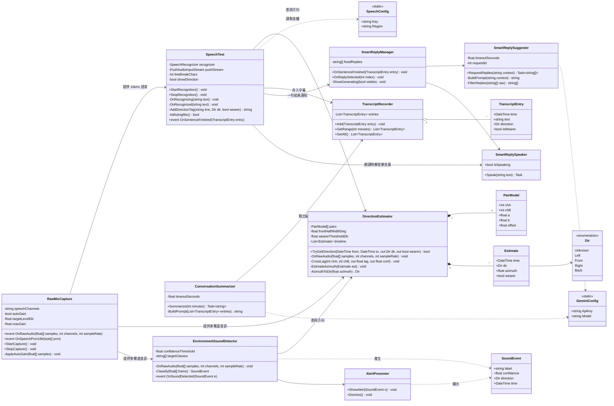
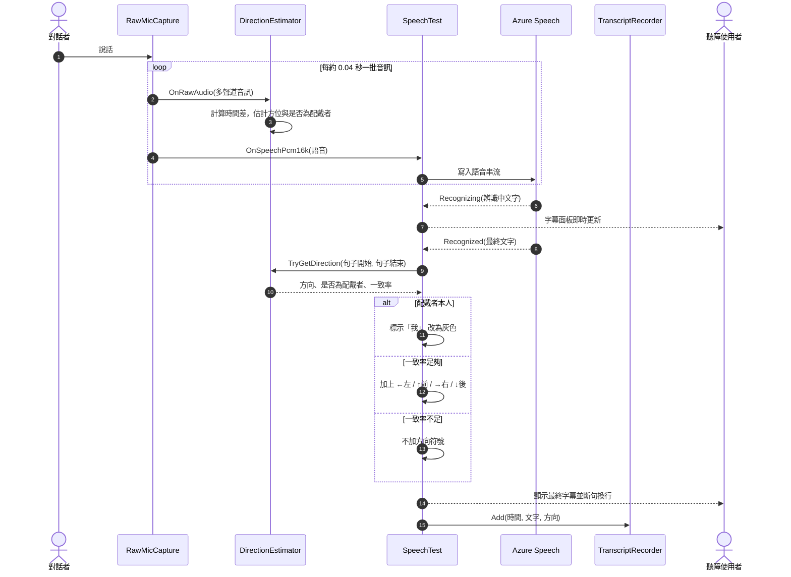
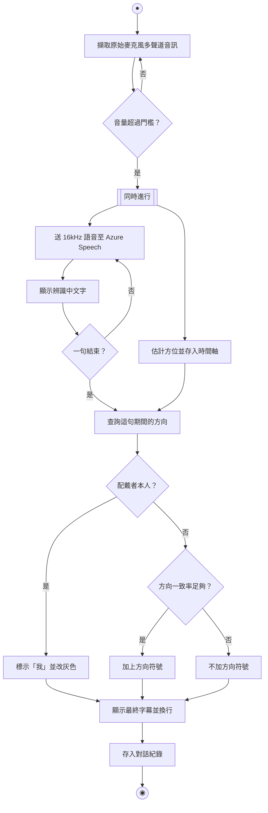
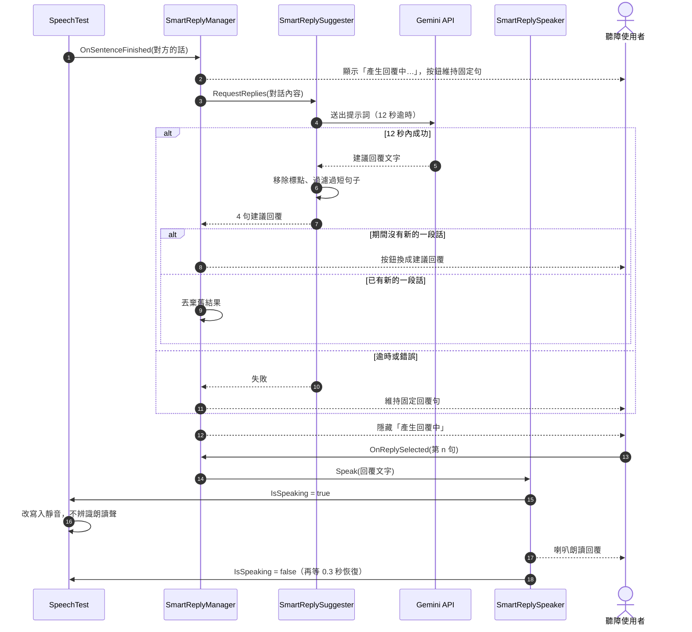
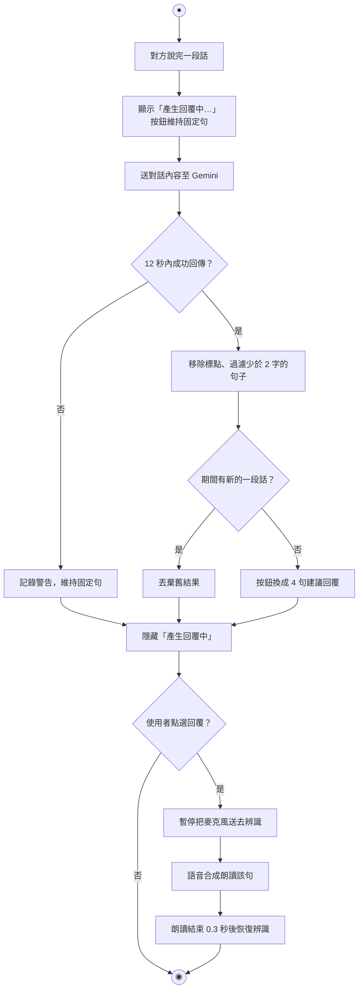
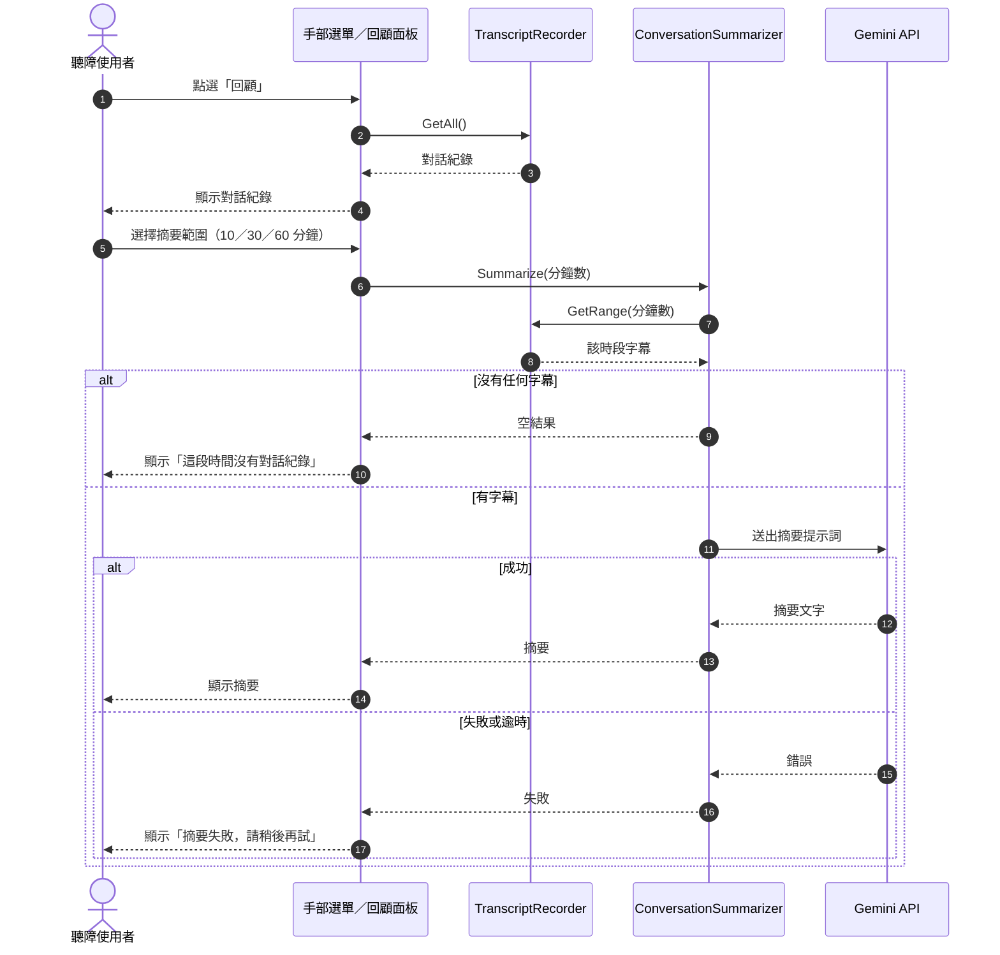
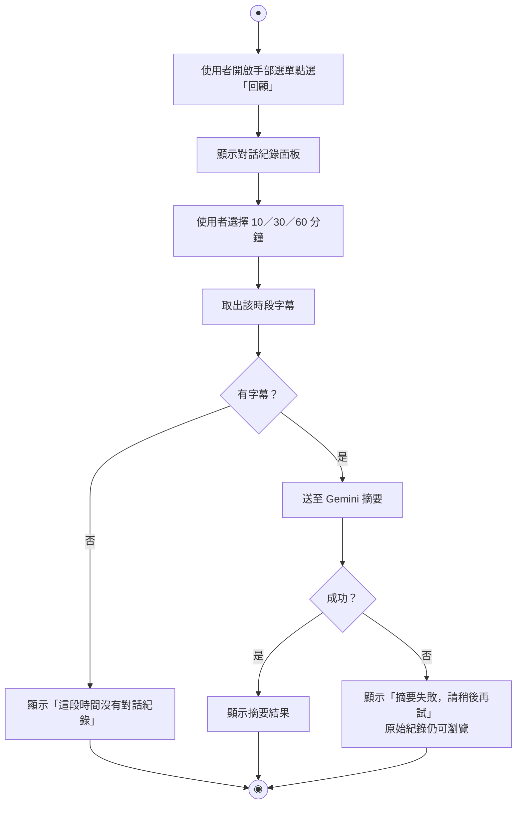

# 作業4：UML 類別圖、循序圖與活動圖

系統分析與設計115-1 第二組｜專題：HoloLens 2 聽障輔助溝通系統

## 一、UML 類別圖（Class Diagram）

類別分工：
- **擷取層**：`RawMicCapture` 以 HoloLens 2 原始麥克風模式擷取多聲道音訊，分送給字幕、方向與環境音三個模組。
- **字幕與方向（李文豪）**：`SpeechTest`、`DirectionEstimator`、`PairModel`、`Estimate`、`Dir`。
- **紀錄、摘要與智慧回覆（高宗佑）**：`TranscriptRecorder`、`TranscriptEntry`、`ConversationSummarizer`、`SmartReplyManager`、`SmartReplySuggester`、`SmartReplySpeaker`。
- **環境音（葉育愷）**：`EnvironmentSoundDetector`、`SoundEvent`、`AlertPresenter`。
- `SpeechConfig`、`GeminiConfig` 存放 API 金鑰，不放進版本控制。

---

## 二、UC1 檢視即時字幕（含說話方向）

### 循序圖

### 活動圖

---

## 三、UC5 選擇智慧回覆

### 循序圖

### 活動圖

---

## 四、UC4 查詢對話摘要

### 循序圖

### 活動圖

